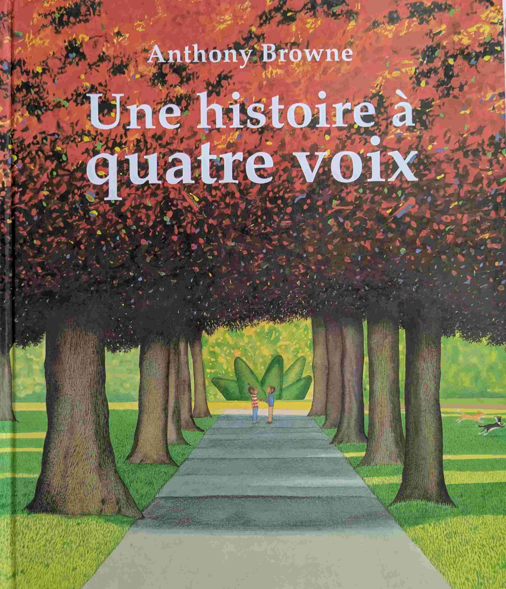
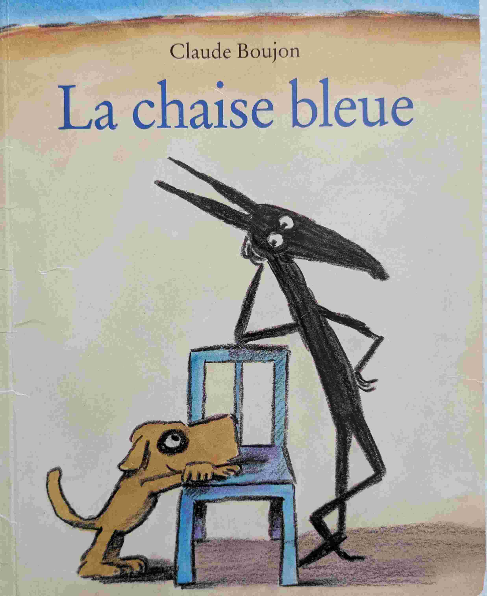
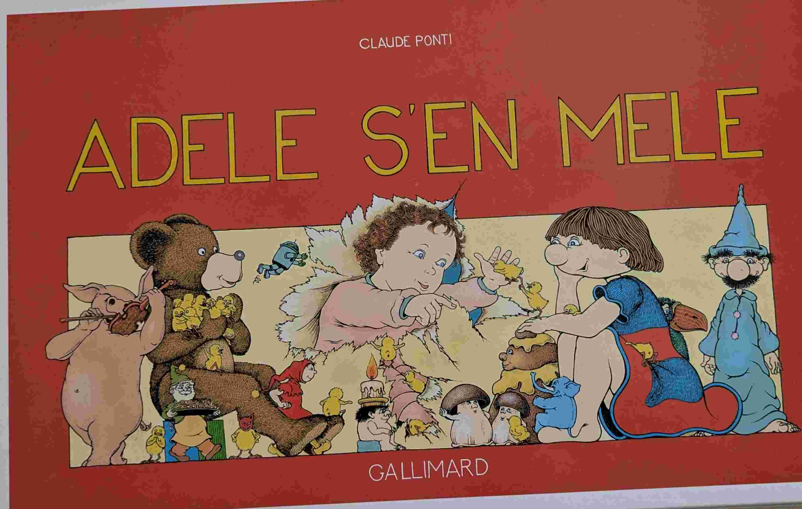
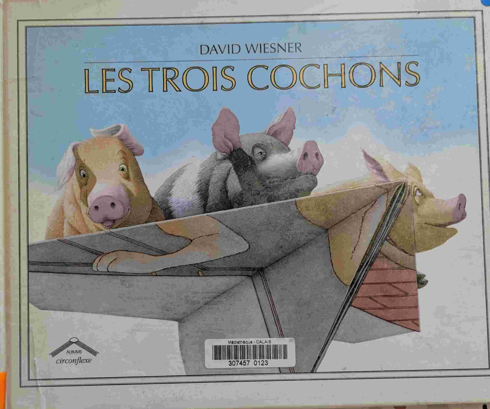
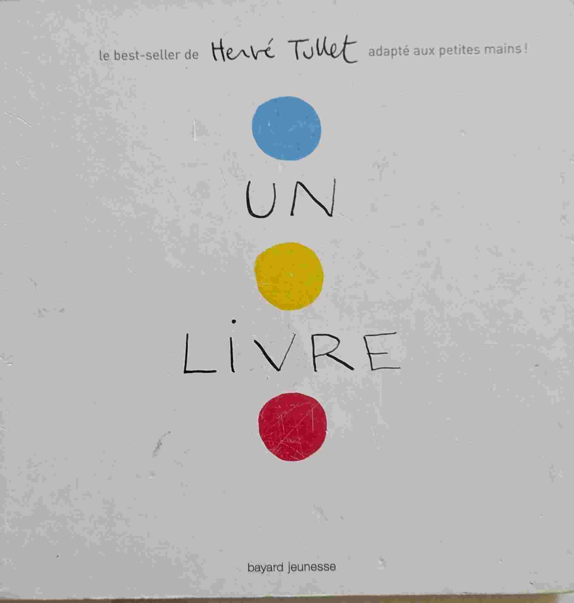
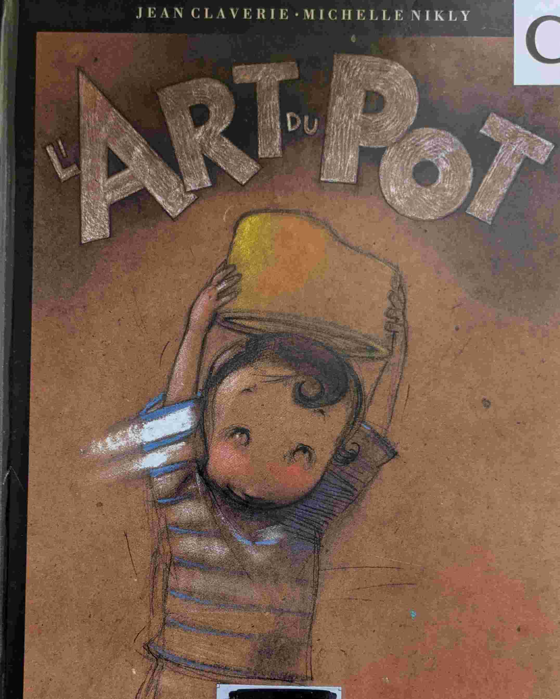
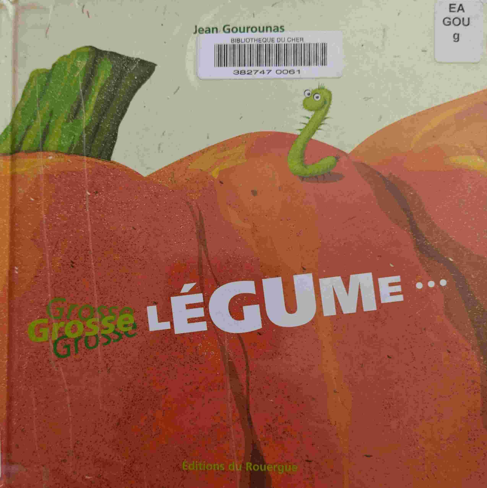
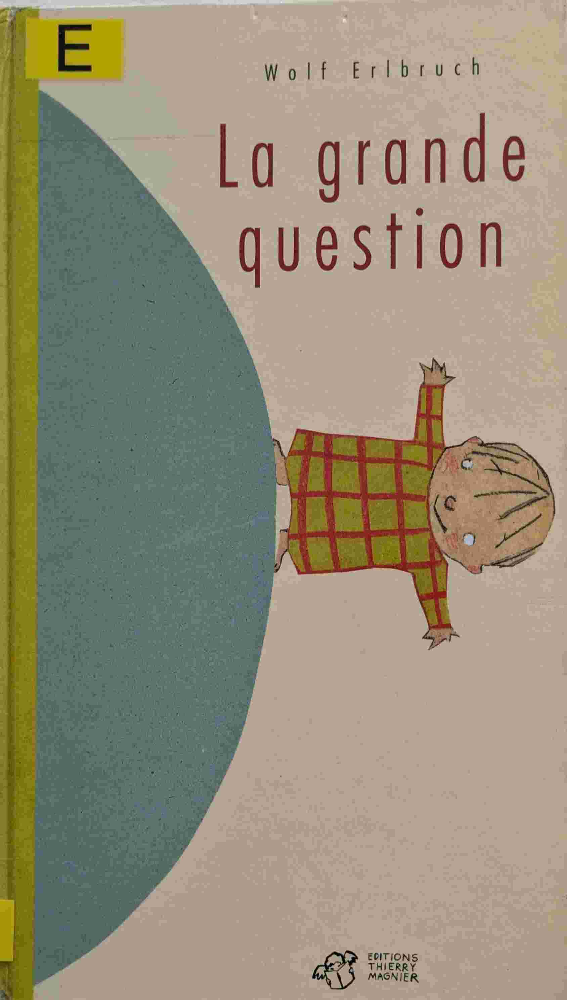

# Prix Sorcière

## Introduction
Le Prix Sorcière est un prix littéraire français décerné chaque année par les libraires spécialisés en littérature jeunesse pour récompenser les meilleurs livres pour enfants.

## Une histoire à quatre voix (*Anthony Browne*)

{ width="100" }

Une histoire racontée par quatre personnages différents, chacun avec sa propre perspective. Très drole, et offre une réflexion sur la subjectivité des points de vue. Les illustrations sont bourrées de détails en arrière-plan: à chaque lecture on découvre un nouveau détail. 

Prix Sorcière 1999 (Catégorie albums)  

## La chaise bleue (*Claude Boujon*)

{ width="100" }

Nous donnons trop de jouets aux enfants. Less is more. La preuve par la chaise

Prix Sorcière 1997 (Prix spécial)  

## Adèle s'en mêle (*Claude Ponti*)

{ width="100" }

Le deuxième volet de la série Adèle. Adèle rentre dans le livre.

Prix Sorcière 1988 (Catégorie tout-petits)  

## Les trois cochons (*David Wiesner*)

{ width="100" }

Une réinterprétation imaginative du conte classique.

Prix Sorcière 2002 (Catégorie albums)  

## Un livre (*Hervé Tullet*)

{ width="100" }

Un livre super interactif pour apprendre couleur, formes et espace. Merci Justine !

Prix Sorcière 2011 (Catégorie tout-petits)  

## L'art du pot (*Jean Claverie et Michele Nikly*)

{ width="100" }

Un super livre pour démystifier le pot. Très drole, très vrai, et de jolis dessins

Prix Sorcière 1991 (Catégorie tout-petits)  

## Grosse Légume (*Jean Gourounas*)

{ width="100" }

À mourir de rire. L'histoire d'un ver qui s'enfile des légumes. Attention, pour que le charme opère, il faut que le lecteur lise le livre de manière rythmique. Les kids en redemandent!

Prix Sorcière 2005 (Catégorie tout-petits)  

## La grande question (*Wolf Erlbruch*)

{ width="100" }

Une introduction à la philosophie pour les enfants. 

Prix Sorcière 2005 (Catégorie albums)  

